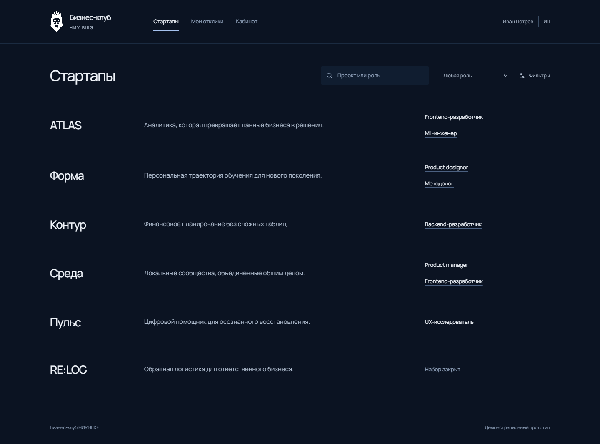
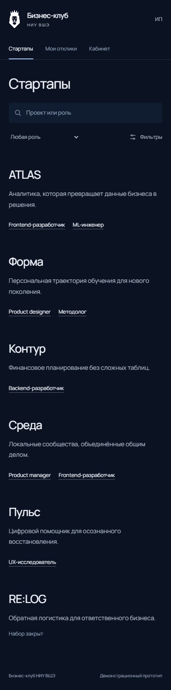
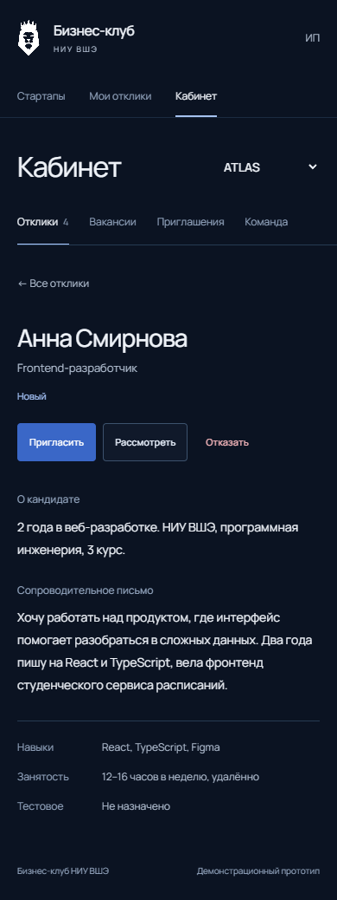
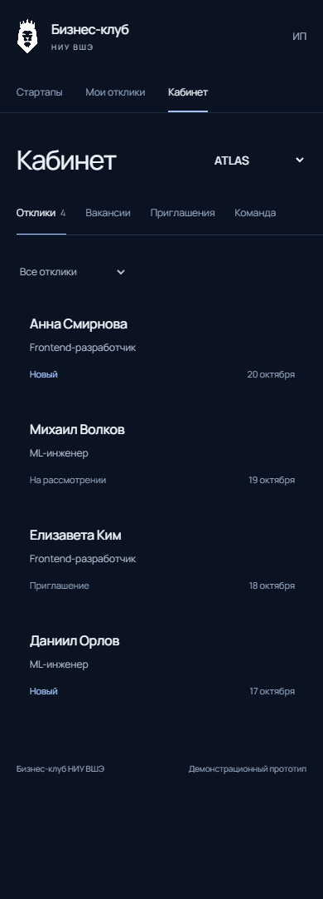

# Startup Team

**Telegram Mini App для поиска людей в стартап-команды.**

Сделал этот проект как тестовое задание для Бизнес-клуба. Идея простая: человек публикует стартап и вакансии, другие участники откликаются, а дальше можно рассмотреть заявки, пригласить людей и собрать команду. Хотелось сделать не просто список вакансий, а весь процесс от поиска до вступления в проект.

**[Открыть в Telegram](https://t.me/test_q_buisness_club_bot)** · **[Веб-версия](https://startup.locatermanhass.ru/)** · **[Запустить локально](#локальный-запуск)**

## Как выглядит



<p align="center">
  
  
  
</p>

<sub>Скриншоты из проекта. Интерфейс адаптирован для компьютера и Telegram на телефоне.</sub>

## Что умеет приложение

- **Стартапы и вакансии.** Можно создать проект, опубликовать вакансии, указать условия, дедлайны и количество мест.
- **Отклики.** Участники находят интересные проекты, отправляют заявки и видят их статус.
- **Приглашения в команду.** Владелец рассматривает кандидатов, отправляет предложения, а кандидат сам решает, принимать ли приглашение.
- **Управление проектом.** Есть кабинет, настройки, история откликов, версии условий, участники команды и права рекрутеров.
- **Telegram.** Вход через Telegram Mini App, первое заполнение профиля, кнопка «Назад» и адаптация под мобильный экран.
- **Уведомления.** Внутренние уведомления и личные сообщения от бота о важных событиях. Из сообщения можно сразу открыть приложение.

### Как попробовать

1. Откройте [@test_q_buisness_club_bot](https://t.me/test_q_buisness_club_bot) и нажмите **Start**.
2. Запустите Mini App через бота и заполните профиль.
3. Создайте стартап с вакансией. С другого Telegram-аккаунта можно откликнуться и пройти весь процесс до приглашения в команду.

Бот отправляет сообщения только тем, кто предварительно начал с ним переписку. На рабочем сервере демо-вход отключён.

## На чём сделано

| Часть | Технологии |
|---|---|
| Backend | Python 3.12, FastAPI, SQLAlchemy Core |
| База данных | PostgreSQL 16, Alembic |
| Frontend | React 19, TypeScript, Vite |
| Запуск | Docker Compose, Nginx, HTTPS через Caddy |
| Интеграция | Telegram Mini App и Telegram Bot API |

На сервере проверяются права доступа, сессии, CSRF и подпись Telegram `initData`. Основные операции с откликами, приглашениями и участниками выполняются транзакционно. Повторные запросы поддерживают ключ идемпотентности, а изменения проверяются по ревизиям.

Более подробно всё расписано в [технических заметках](docs/TECHNICAL_DETAILS.md) и [машинах состояний](docs/STATE_MACHINES.md).

## Локальный запуск

Понадобится Docker с Compose v2. Для локальной проверки есть три вымышленных демо-аккаунта. Реальный Telegram-бот не нужен.

**macOS / Linux**

```bash
cp -n .env.example .env
docker compose -p startup_team_demo up --build -d
```

**Windows (PowerShell)**

```powershell
Copy-Item .env.example .env
docker compose -p startup_team_demo up --build -d
```

После запуска откройте **http://127.0.0.1:8080**. Первый запуск может занять немного времени из-за сборки образов и миграций.

| Имя | Email | Пароль |
|---|---|---|
| Иван | `ivan@example.test` | `demo-ivan-123` |
| Мария | `maria@example.test` | `demo-maria-123` |
| Алекс | `alex@example.test` | `demo-alex-123` |

Можно зайти под Иваном, создать вакансию, а под Марией откликнуться и проверить, как работает весь сценарий. Это именно локальные тестовые аккаунты, их нельзя использовать как авторизацию для публичного сервера.

Для остановки без удаления данных:

```bash
docker compose -p startup_team_demo down
```

Не используйте `down -v`, если хотите сохранить данные PostgreSQL. Если обновляете существующий запуск, сначала сделайте резервную копию.

## Тестирование

После реализации я провёл отдельные ревью безопасности, бизнес-логики, базы данных, интерфейса и инфраструктуры. По найденным проблемам добавлялись исправления и регрессионные тесты.

Последний полный прогон на коммите [`789931e`](https://github.com/locaterman/startup-team/commit/789931ef94604ef91a4c1294b84c5a45c68c647a) завершился успешно:

- **123 backend-теста** и **20 браузерных E2E-тестов** на Chromium, плюс проверки Docker Compose и восстановления PostgreSQL. [Результаты CI](https://github.com/locaterman/startup-team/actions/runs/40031522503).
- **Frontend-проверки и сборка** прошли. [Результаты CI](https://github.com/locaterman/startup-team/actions/runs/40031522498).
- На своём сервере я отдельно проверил реальный вход через Telegram и получение уведомления от бота о новом отклике.

Тесты запускаются на отдельных базах, а не на рабочем сервере. Как воспроизвести проверки и что именно они покрывают, есть в [технических заметках](docs/TECHNICAL_DETAILS.md).

## Использование AI

Я использовал ИИ на протяжении всей разработки. Сначала мы продумывали архитектуру: ИИ задавал вопросы, предлагал варианты, я отвечал, уточнял, что хочу получить, и выбирал решения. Заодно разбирали разные нестандартные ситуации, чтобы потом не возникало проблем с логикой.

После этого ИИ начал писать код и делать ревью, я проверял результат. Больше всего возился с дизайном: говорил, что выглядит странно, где неудобно или непонятно. Правда, не уверен, что мои дизайнерские способности сильно помогли, но мы хотя бы пытались.

Потом я запустил несколько отдельных ИИ-ревью: по безопасности, архитектуре, бизнес-логике, фронтенду и тестам. Смотрел, что они находят, выбирал, что стоит исправить, и мы постепенно дорабатывали проект.

Были и ошибки. Например, ИИ написал скрипт для обновления приложения на сервере, но при первом запуске что-то пошло не так и произошёл откат. Я проверил ответы API и настройки сервера, мы нашли ошибку в проверке готовности и исправили её.

В итоге развернул приложение на своём сервере, проверил, как оно работает в Telegram, и протестировал уведомления от бота.

## Сколько времени ушло

Примерно **15 часов активной работы**. Сюда входят обсуждение архитектуры, backend, frontend, ревью, тесты, исправления и развёртывание. Поминутный учёт не вёл, так что это моя оценка.

## Что пока не делал

Это MVP, поэтому здесь нет AI-подбора кандидатов, email-рассылок и полноценной очереди доставки Telegram-уведомлений с повторами. Если бот недоступен, бизнес-операция всё равно сохраняется, а уведомление остаётся внутри приложения.

## Документы

- [Подробности архитектуры, миграций и тестов](docs/TECHNICAL_DETAILS.md)
- [Правила переходов между состояниями](docs/STATE_MACHINES.md)
- [OpenAPI-контракт](contracts/openapi.yaml)
- [Развёртывание Telegram Mini App на Debian](docs/TELEGRAM_DEBIAN_STAGING.md)
- [История разработки и ревью, PR №1](https://github.com/locaterman/startup-team/pull/1)
